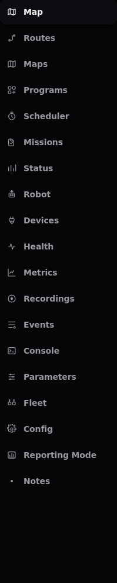
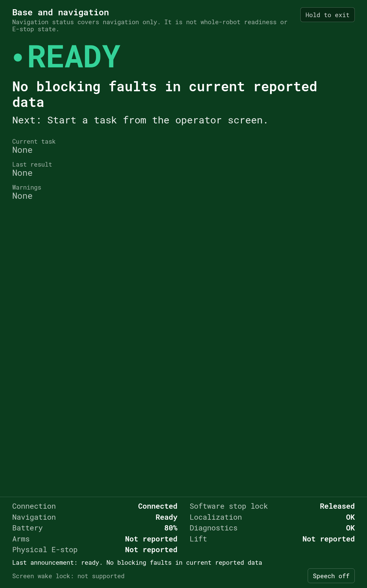
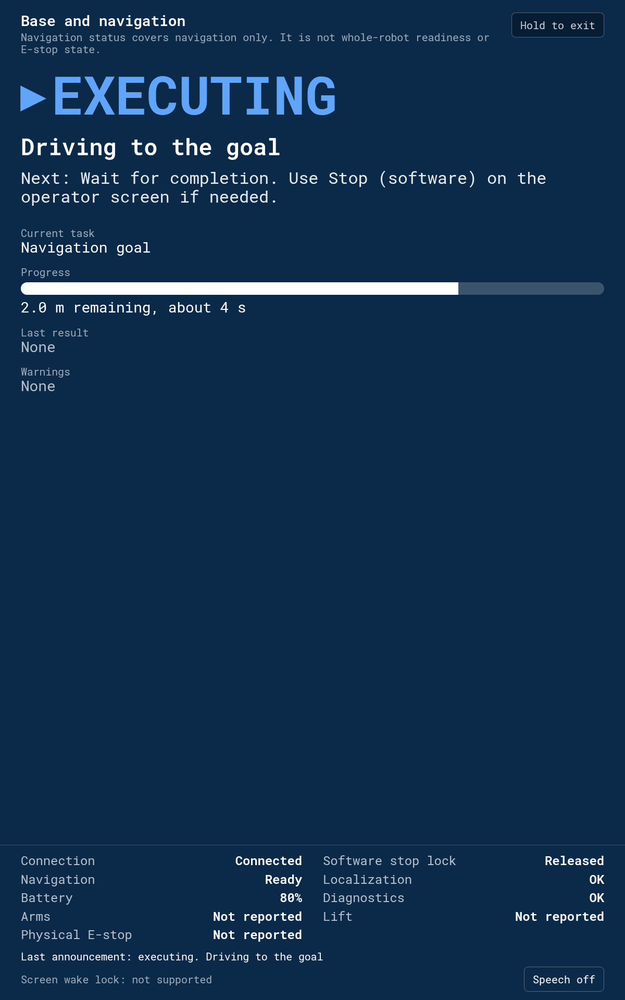
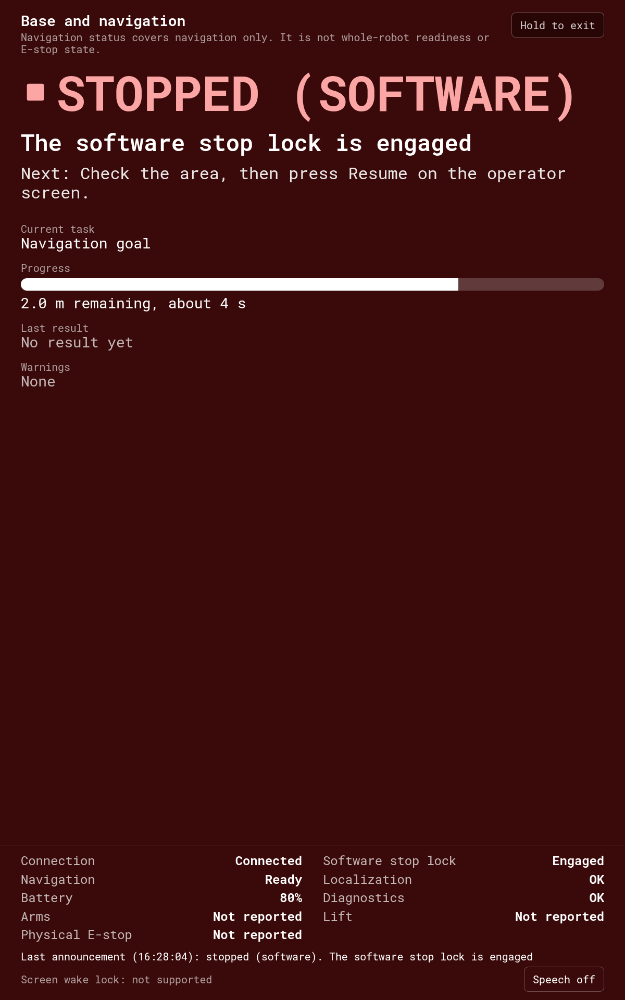
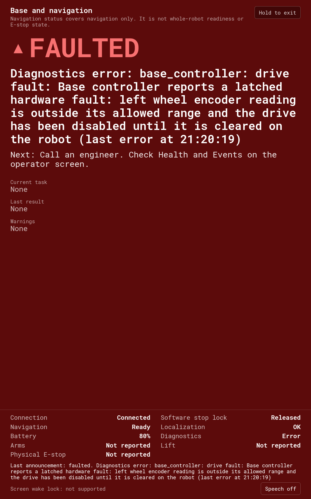
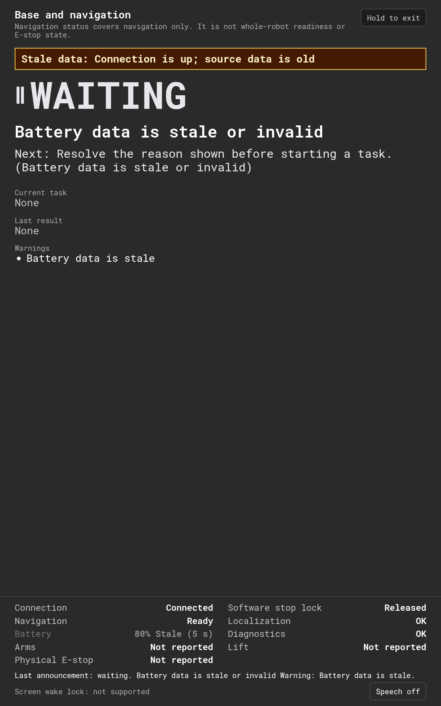
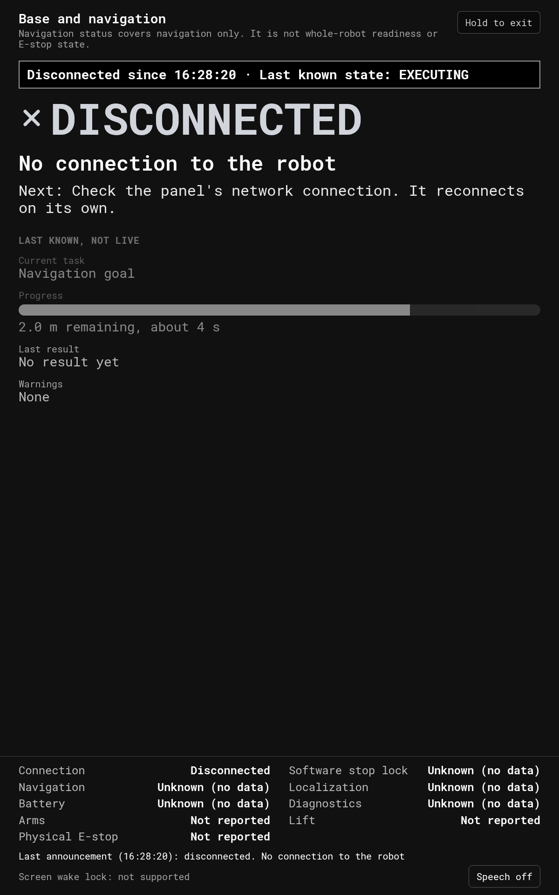
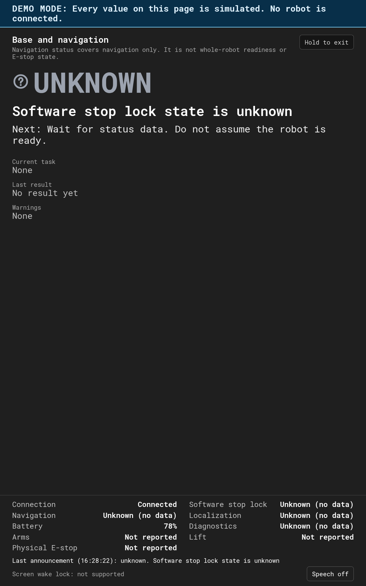

# Reporting Mode

Reporting Mode is a read-only, full-screen page at `/report` for the
operator panel: the Getac ZX80, 8 inch, 1920 x 1200, portrait only on a
fixed mount (149.8 mm wide x 234 mm tall, no rotation and no landscape
position; TABLET-MOUNT, decision of 2 Nov 2026), Android Chrome. The page
is laid out for a 1200 wide by 1920 tall screen. It shows what the robot
base and navigation are doing in large type, readable from a few metres
away. It has no command of any kind.

Scope is base and navigation only. The page header says "Base and
navigation". Navigation status reports navigation health only. It is not
whole-robot readiness, arm or base authority, or E-stop state. The rows for
Arms, Lift and Physical E-stop show "Not reported" until a producer for
them exists.

Reporting Mode is development and integration tooling. It is never safety
evidence, and a value shown here is never a safety indication.

## Using it

1. Open `http://<robot>:5050/report` on the panel.
2. The page asks the browser to keep the screen on (Screen Wake Lock) when
   the browser supports it. The footer shows the result. Browsers only allow
   it on a secure (HTTPS) page, so over plain HTTP it shows "not supported".
   On the panel the screen is kept on by the panel setup below instead.
3. To leave, press and hold the "Hold to exit" control in the top right
   corner for 2 s. A short tap does nothing.
4. Speech is off by default. "Speech off" in the footer switches it on for
   this page. Each state change, result, warning and completion is spoken
   once. Switching speech on does not read out what is already on screen,
   and a disconnect and reconnect does not repeat anything. The latest
   announcement text is shown in the footer whether or not speech is on,
   with the panel time it was made, for example "Last announcement
   (09:41:05): ready. ...", so it reads as a past event. When the page
   goes back to the state it was in before a disconnect, nothing is
   spoken, but the footer text is replaced by the current state, so it
   never names a state the page has left.

Observable success: with the robot stack and rosbridge running, the page
shows a state word (for example READY or WAITING), a reason, and a row of
sources at the bottom with no "Stale" marks.

When a source is stale while the connection remains up, the page shows a
stale-data banner, dims stale source rows, and shows each stale source's age
in seconds. When rosbridge disconnects, a separate banner says "Disconnected since"
with the panel time the connection was lost, and the last known state.
The current task and progress stay on screen dimmed, under a "Last known,
not live" label. Warnings are old data too, so they are dimmed with the
task block, and an empty list shows "Unknown" instead of "None". The
disconnected view is not presented as live.

## Operator states a wall panel must tell apart

These four were measured on the merged pair and are the ones to check
against the code (`reportingAdapter.js`) and `ReportingPage.test.jsx`:

| Situation | Page shows | Source |
|---|---|---|
| Stopped by the software lock (`/safety/stop_lock` true) | STOPPED (SOFTWARE) | lock state locked |
| Lock state unknown (no sample, or stale; fails closed) | UNKNOWN, "Software stop lock state is unknown" | lock state unknown |
| rosbridge disconnected | DISCONNECTED, "Disconnected since", last known state | connection |
| Running | EXECUTING, with task and progress | navigation status |

STOPPED (SOFTWARE) and DISCONNECTED must not look alike on a screen, and
stale data (connection up, a source old) is a fifth, separate view. The
software stop lock is not the hardwired E-stop.

## Demo Mode

The app's Demo Mode banner is part of the main layout, and this page is
outside it. So when Demo Mode is on, the page shows its own label at the
top: "Demo mode: Every value on this page is sample data, not from a
robot." The route smoke test (`web/e2e/routes.spec.js`) checks that
this label is visible.

## Panel setup

On the Getac ZX80 operator panel, set the screen timeout to Never in the
Android display settings. Screen Wake Lock needs HTTPS, and the panel loads
the UI over plain HTTP on the robot network, so the page cannot keep the
screen on by itself there. The Wake Lock request stays in the page for
browsers and deployments where it is allowed.

Also on the ZX80, keep "Automatic date and time" on in the Android date and
time settings. The time shown with a diagnostics fault ("last error at" or
"last fault at") comes from the panel's own clock, so it is correct only
while the panel clock is set automatically.

## Layout

One column, top to bottom: the header with the exit control at its right
end, the state word, the reason and next action, then task, progress, last
result and warnings, and the source rows in two columns at the bottom. The
state word shrinks with the page width so that the longest unbroken word
fits, in English or German (WIEDERHERSTELLUNG, 17 characters; a Jest test
checks every state word against this); long diagnostic names and reasons
wrap. Up to 8
warnings are listed; any more are counted ("3 more not shown").

The panel is 1200 physical pixels wide, but the page width in CSS px
depends on the display scale Chrome uses there (the page sets
`width=device-width`), which is not confirmed. Every type size, padding
and gap is therefore a share of the page width (its 1200 px value divided
by 1200, times the width), capped at the 1200 px value. The text then has
the same physical size on the panel whatever the scale. If the content
still does not fit, the middle of the page scrolls; the header and the
source rows stay on screen.

The reference layout was checked in Chromium at 1200 x 1920, 800 x 1280 and 600 x 960
(display scales 1, 1.5 and 2). The check looked for elements outside the
screen, clipped text, text wider than its box, the exit control covering
header text, and a middle that needs scrolling. It used seven scripted
screens, including a long fault reason with four sources and a long
unbroken diagnostic name. None was found at any size. A screen with a much
longer reason and eleven warnings scrolls the middle at 600 x 960 with the
source rows still on screen. That is a browser check with a scripted
rosbridge stand-in, not a check on the Getac ZX80.

## Screenshots

Taken at 1200 x 1920 (portrait) with a scripted rosbridge stand-in
(development evidence only, not the robot). The FAULTED screen shows a
latched diagnostics fault with a long reason; the same screen at 600 x 960
is [faulted-600x960.png](reporting-mode/faulted-600x960.png):

The Reporting Mode entry in the sidebar:

| READY | EXECUTING | STOPPED (SOFTWARE) |
|---|---|---|
|  |  |  |

| FAULTED | Stale battery | DISCONNECTED |
|---|---|---|
|  |  |  |

The page in Demo Mode, with its own Demo Mode label (Demo Mode has no stop
lock sample, so the state is UNKNOWN):

## What the page shows

- State, from the list below, with the reason in plain words.
- Next permitted action. The page itself is read-only, so the action points
  to the operator screen (for example "press Resume on the operator
  screen").
- Current task: mission, program or route with "Step n of m", or a bare
  navigation goal.
- Progress from Nav2 feedback: distance remaining, estimated time,
  recoveries.
- Last result with its reason, warnings, and a completion message.
- One row per source with its freshness.

## Sources

| Source | Topic and type | Publish behaviour | Stale after |
|---|---|---|---|
| Connection | rosbridge WebSocket (roslibjs `connection`, `close`, `error`) | rosbridge_suite 2.7.1 has WebSocket ping off by default (`websocket_ping_interval` 0.0) and a browser cannot observe pings, so there is no protocol heartbeat | Disconnected on `close` or `error` |
| Software stop lock | `/safety/stop_lock`, `std_msgs/Bool` | Republished on every 20 Hz tick of the stop gate (`TICK_HZ` 20, openamr-platform-sw#90) | 1 s (20 missed ticks). This also serves as the link heartbeat. |
| Navigation | `/navigation/status`, `openamr_nav_msgs/NavigationStatus` (contract version 1) | On change, and at least once per 2 Hz heartbeat | 1.5 s (3 heartbeats) |
| Diagnostics | `/diagnostics`, `diagnostic_msgs/DiagnosticArray` | The navigation status node mirrors it on every 10 Hz tick | 1 s (10 ticks), per entry name |
| Battery | `/battery_status`, `std_msgs/Float32` percent | 1 s timer in `battery.py` | 3 s (3 periods) |
| Goal status | `/ui/navigate_to_pose/status`, `action_msgs/GoalStatusArray` | On change (relayed from `/navigate_to_pose/_action/status`) | Not a freshness source |
| Goal progress | `/navigate_to_pose/_action/feedback`, `NavigateToPose_FeedbackMessage` | On progress | Shown only while the goal is active |
| Mission | browser mission runner store | This browser tab only | Not a freshness source |
| Program, route | browser run store (`shared/runs/uiRunStore.js`) | This browser tab only | Not a freshness source |

The thresholds (3 heartbeats, 10 and 20 ticks, 3 periods) and the 25% battery
limit are accepted defaults (owner decision, 30 Oct 2026). The view is re-derived every
250 ms, so a source turns stale on screen without new data.

Mission, program and route runs are what this browser tab is running. They
do not establish what the robot did, and another device does not see them.
A robot-side run envelope is proposed in
[proposals/i5-run-state.md](proposals/i5-run-state.md).

## States

Every state (READY, EXECUTING, WAITING, BLOCKED, RECOVERING,
NEEDS_ASSISTANCE, SAFETY_STOPPED, FAULTED, STOPPED (SOFTWARE), UNKNOWN and
DISCONNECTED) has its own icon and high-contrast color, with its state name
also shown as text. The icons are inline SVG drawn in the state color, so
they look the same on every device (no emoji or font glyphs). SAFETY_STOPPED remains reserved for a
future physical safety-chain status producer and is not derived by this
adapter.

`SAFETY_STOPPED` is reserved for a future physical safety-chain status
producer. This adapter never derives it, and never from the software stop
lock. A `NavigationStatus` E-stop reason code (9003) is only shown as a
navigation reason, never as an E-stop state.

### State priority

The first rule that matches wins.

| Priority | State | When |
|---|---|---|
| 1 | DISCONNECTED | rosbridge is not connected |
| 2 | STOPPED (SOFTWARE) | the stop lock is known and engaged |
| 3 | UNKNOWN | the stop lock has no sample or is stale |
| 4 | FAULTED | a `/diagnostics` source is latched in fault (see "Diagnostics fault latch") |
| 5 | UNKNOWN | navigation status is missing, stale or invalid (wrong `contract_version`, out-of-range fields) |
| 6 | FAULTED | navigation `health` is FAULT; stack state FAILED; stack state UNKNOWN with reason 1004 (node inactive); reason 1005 or 4009 |
| 7 | NEEDS_ASSISTANCE | reason 5002 (recovery attempts used up) or 4007 (stuck); localization state LOST |
| 8 | RECOVERING | task state RECOVERING, or a recovery action is running |
| 9 | BLOCKED | an active reason 4002, 4003, 4004 or 4008 |
| 10 | WAITING | a mission is in a wait step |
| 11 | EXECUTING | navigation task ACTIVE, a goal ACCEPTED, EXECUTING or CANCELING, or a mission, program or route running |
| 12 | READY | all of: health OK, `navigation_readiness` READY, at least one valid, fresh `/diagnostics` entry and no source latched in fault, battery fresh and above 25% |
| 13 | WAITING | otherwise, with the first blocking reason shown |

READY says only what the page knows. Its reason is "No blocking faults in
current reported data", or "Ready, with reported warnings shown below" when
there are warnings (for example a diagnostics WARN). It does not mean every
check on the robot passes: after a reconnect, a source that has not reported
again is not known.

A known, engaged software lock ranks above UNKNOWN navigation data (missing,
stale or invalid); only DISCONNECTED ranks higher. This is the owner's
decision: the lock is the fact the operator acts on (Resume). Stale or
invalid navigation data then shows as a warning. An unknown lock is itself
UNKNOWN.

On disconnect, the page keeps the last derived live state in a separately
labelled "Last known state" field. It does not carry old telemetry values
forward into the new connection epoch.

READY cannot appear on today's simulation: the navigation status node keeps
`navigation_readiness` at NOT_READY with reason 9001 (no link to the base
controller) until a base status adapter exists. The page then shows WAITING
with "No link to the base controller", which is the correct reading.

Low battery: 25% or less blocks READY. Basis: the UI plan's initial battery
policy "return at 25% SOC", subject to commissioning. Accepted default
(30 Oct 2026).

### Diagnostics validation

Owner decision, 30 Oct 2026:

- A `/diagnostics` message must have a `status` array. One without it is
  ignored and logged to the event log.
- Each entry needs a non-empty `name` and a `level` of exactly 0, 1, 2 or 3
  (OK, WARN, ERROR, STALE; rosbridge sends the byte as an integer). An
  invalid entry is ignored and logged. A message with no valid entries does
  not count as received.
- Each valid entry is stored with its own receive time, by name. An entry
  older than 1 s drops out of evaluation. A message about one name never
  refreshes another name's entry.
- READY needs at least one valid, fresh entry and no source latched in
  fault. With no valid fresh entry the page shows WAITING ("No valid
  diagnostics received" or "Diagnostics are stale").
- The Diagnostics row shows Error while any source is latched in fault,
  otherwise Unknown (no valid fresh entry), Warning or OK. Its age is the
  time since the newest entry, like the other rows, so one source that
  stopped reporting long ago does not make the row look hours old.

### Diagnostics fault latch

Owner decision, 30 Oct 2026 (second review point on #54):

- When an entry with a given name reports ERROR or STALE, that name stays
  in fault until the same name reports a valid OK or WARN. Ageing out never
  clears a fault, and reports from other names never clear it. An invalid
  entry for that name does not clear it either.
- While any name is in fault the page shows FAULTED, and READY is
  impossible. The reason names the source and the panel's local time of its
  last fault report, for example "Diagnostics error: lidar: no data (last
  error at 09:41:05)" or "Diagnostics stale: camera (last fault at
  09:41:05)". With several sources in fault, the one that reported
  last is the reason and the others are listed as warnings.
- A latched fault ranks below DISCONNECTED and the software stop lock rules
  (priorities 1 to 3) and above missing or stale navigation data.
- A fault is cleared only by a recovery report (OK or WARN) from the same
  name, or by a new rosbridge connection. A new connection starts with no
  diagnostics at all, so the page shows WAITING ("No valid diagnostics
  received") until valid diagnostics arrive again. A source still in fault
  then latches again on its next ERROR or STALE report.

### Next permitted action

| State | Next action |
|---|---|
| DISCONNECTED | Check the panel's network connection. It reconnects on its own. |
| UNKNOWN | Wait for status data. Do not assume the robot is ready. |
| STOPPED (SOFTWARE) | Check the area, then press Resume on the operator screen. |
| FAULTED | Call an engineer. Check Health and Events on the operator screen. |
| NEEDS_ASSISTANCE | An operator is needed at the robot (with the reason). |
| RECOVERING | Wait. The robot is trying to recover. |
| BLOCKED | Clear the path, or cancel the task on the operator screen. |
| EXECUTING | Wait for completion. Use Stop (software) on the operator screen if needed. |
| WAITING | Resolve the reason shown before starting a task (with the reason). |
| READY | Start a task from the operator screen. |

### Reason codes

Navigation reason codes are shown in plain words. The full table is
`REASON_TEXT` in `web/src/shared/reporting/reportingAdapter.js`; an unknown
code shows as "Navigation reason N". Reasons 6001 to 6008 (protection) and
a DEGRADED navigation health are shown as warnings.

## Runs and results

- A new goal id, or a mission start, opens a new run and clears the result
  panel. A waypoint queue whose first goal is not sent (the stop lock
  engaged, or the goal topic not ready) is recorded as stopped with the
  reason and never shows as running. A mission, program or route that sent a goal stays the current
  task.
- Goal events are ordered by goal id and stamp. A duplicate status is
  ignored. A goal older than the current one, or a goal id seen before, is
  ignored. A terminal outcome (SUCCEEDED, CANCELED, ABORTED) is latched.
- An unknown or malformed outcome (a goal status outside 0 to 6, or an
  unknown mission or program status) keeps the run open, shows "Result
  unknown (invalid data)" as a warning, and writes one entry to the event
  log. A later valid outcome for the same run replaces it.
- An ABORTED result carries the navigation task reason in plain words.
- A reconnect starts every source as unknown. The current run and the last
  result stay on screen.

## Read-only guarantee

Nothing under `web/src/shared/reporting/` or the page publishes, advertises,
or calls a service or action. `web/src/shared/reporting/readOnly.test.jsx`
checks this at runtime with a mocked ROSLIB and statically over the source
files.

## Proposed defaults to confirm on the panel

The stale thresholds and the battery limit above are accepted. These
display values remain proposed until checked on the Getac ZX80. Sizes are CSS px
for a 1200 x 1920 page and scale down in proportion on a narrower page (see
Layout).

| Item | Value |
|---|---|
| State word | 120 px, or less on a narrower page (the page width less 80 px, divided by 12) |
| Reason | 44 px |
| Next action | 32 px |
| Body text | 28 px |
| Source rows | 24 px |
| Small labels | 20 px |
| Exit long press | 2 s |
| Warnings listed | 8, then a count |
| View refresh | 250 ms |

## Known gaps

- German is done for the page labels, the state words and the source row
  values. The text that comes from the adapter is still English: reasons,
  next actions, task labels ("Mission: ...", "Step n of m"), warnings and
  the completion text. That waits for the shared adapter from #21.
- "Not-Halt" is used for E-stop in German throughout the page. Not yet
  confirmed by the owner.
