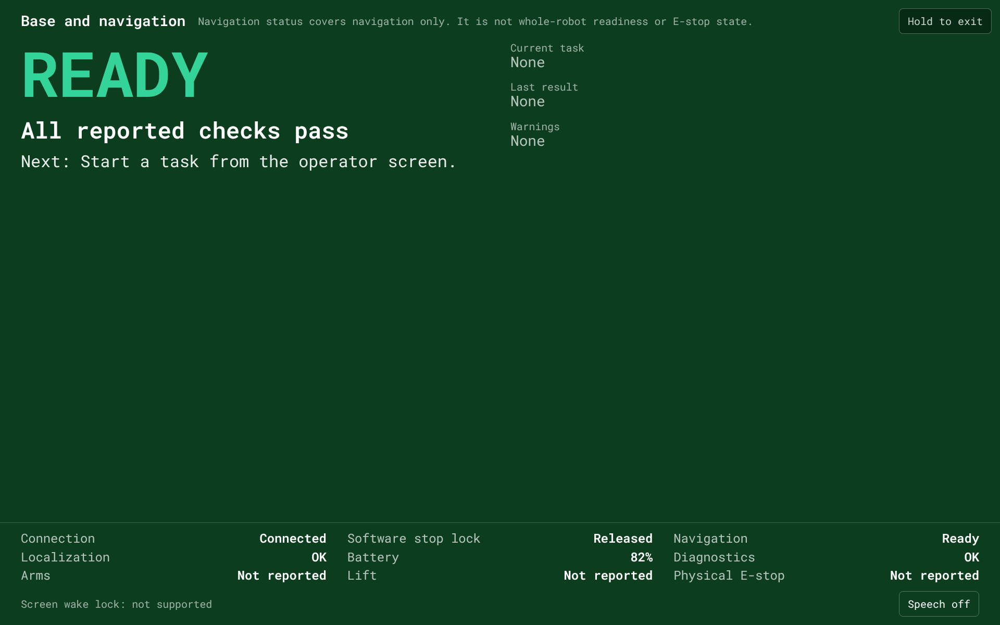
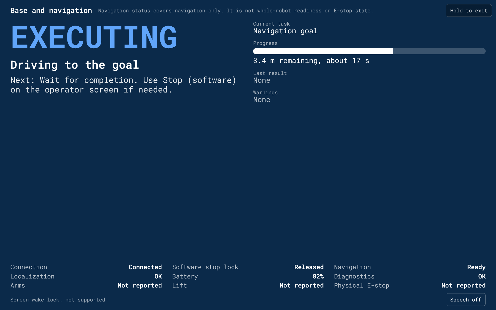
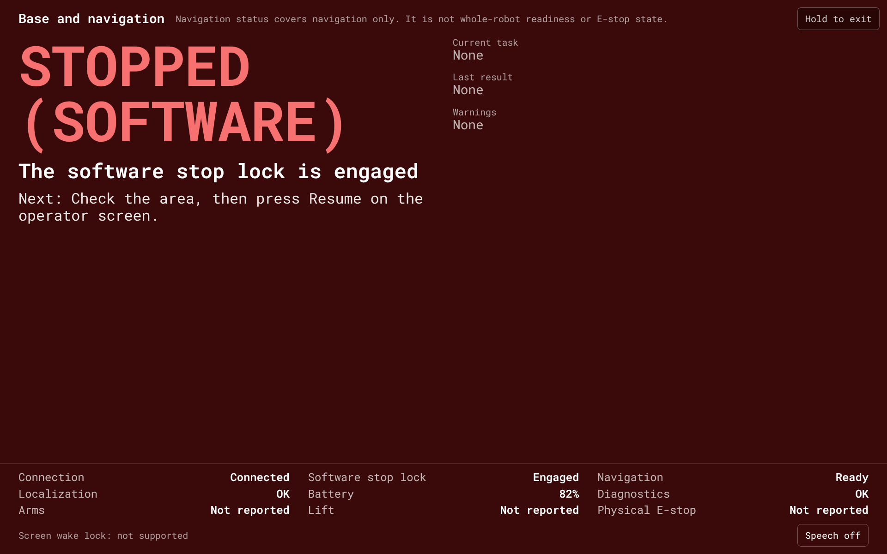
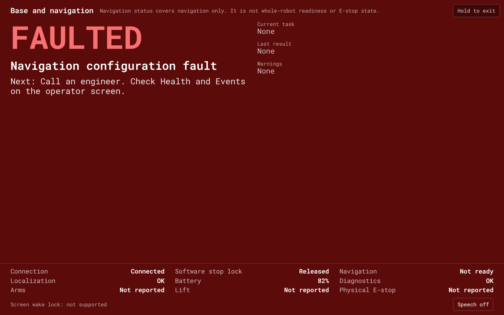
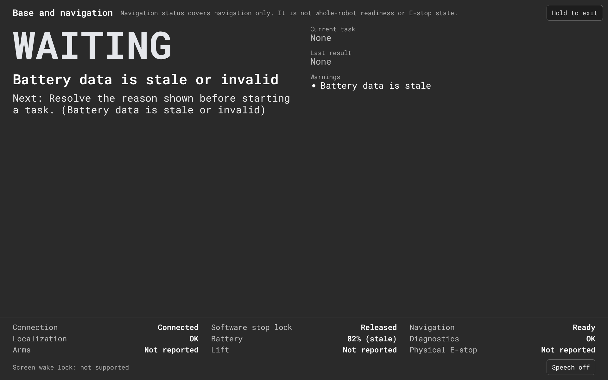
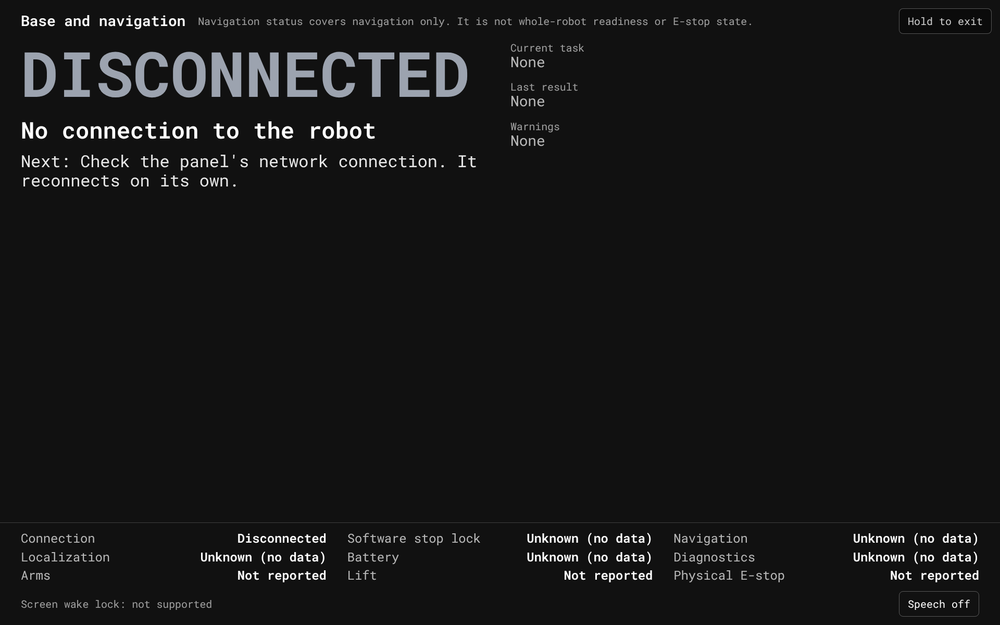

# Reporting Mode

Reporting Mode is a read-only, full-screen page at `/report` for the
detachable operator panel (reference panel: 8 inch, 1920 x 1200, landscape,
Android Chrome). It shows what the robot base and navigation are doing in
large type, readable from a few metres away. It has no command of any kind.

Scope is base and navigation only. The page header says "Base and
navigation". Navigation status reports navigation health only. It is not
whole-robot readiness, arm or base authority, or E-stop state. The rows for
Arms, Lift and Physical E-stop show "Not reported" until a producer for
them exists.

Reporting Mode is development and integration tooling. It is never safety
evidence, and a value shown here is never a safety indication.

## Using it

1. Open `http://<robot>:5050/report` on the panel.
2. The page asks the browser to keep the screen on (Screen Wake Lock) when
   the browser supports it. The footer shows the result. Browsers only allow
   it on a secure (HTTPS) page, so over plain HTTP it shows "not supported".
   On the panel the screen is kept on by the panel setup below instead.
3. To leave, press and hold the "Hold to exit" control in the top right
   corner for 2 s. A short tap does nothing.
4. Speech is off by default. "Speech off" in the footer switches it on for
   this page. Each state change, result, warning and completion is spoken
   once. Switching speech on does not read out what is already on screen,
   and a disconnect and reconnect does not repeat anything.

Observable success: with the robot stack and rosbridge running, the page
shows a state word (for example READY or WAITING), a reason, and a row of
sources at the bottom with no "(stale)" marks.

## Panel setup

On the Getac ZX80 operator panel, set the screen timeout to Never in the
Android display settings. Screen Wake Lock needs HTTPS, and the panel loads
the UI over plain HTTP on the robot network, so the page cannot keep the
screen on by itself there. The Wake Lock request stays in the page for
browsers and deployments where it is allowed.

## Screenshots

Taken at 1920 x 1200 with a scripted rosbridge stand-in (development
evidence only, not the robot):

| READY | EXECUTING | STOPPED (SOFTWARE) |
|---|---|---|
|  |  |  |

| FAULTED | Stale battery | DISCONNECTED |
|---|---|---|
|  |  |  |

## What the page shows

- State, from the list below, with the reason in plain words.
- Next permitted action. The page itself is read-only, so the action points
  to the operator screen (for example "press Resume on the operator
  screen").
- Current task: mission, program or route with "Step n of m", or a bare
  navigation goal.
- Progress from Nav2 feedback: distance remaining, estimated time,
  recoveries.
- Last result with its reason, warnings, and a completion message.
- One row per source with its freshness.

## Sources

| Source | Topic and type | Publish behaviour | Stale after |
|---|---|---|---|
| Connection | rosbridge WebSocket (roslibjs `connection`, `close`, `error`) | rosbridge_suite 2.7.1 has WebSocket ping off by default (`websocket_ping_interval` 0.0) and a browser cannot observe pings, so there is no protocol heartbeat | Disconnected on `close` or `error` |
| Software stop lock | `/safety/stop_lock`, `std_msgs/Bool` | Republished on every 10 Hz tick of the stop gate | 1 s (10 missed ticks). This also serves as the link heartbeat. |
| Navigation | `/navigation/status`, `openamr_nav_msgs/NavigationStatus` (contract version 1) | On change, and at least once per 2 Hz heartbeat | 1.5 s (3 heartbeats) |
| Diagnostics | `/diagnostics`, `diagnostic_msgs/DiagnosticArray` | The navigation status node mirrors it on every 10 Hz tick | 1 s (10 ticks), per entry name |
| Battery | `/battery_status`, `std_msgs/Float32` percent | 1 s timer in `battery.py` | 3 s (3 periods) |
| Goal status | `/ui/navigate_to_pose/status`, `action_msgs/GoalStatusArray` | On change (relayed from `/navigate_to_pose/_action/status`) | Not a freshness source |
| Goal progress | `/navigate_to_pose/_action/feedback`, `NavigateToPose_FeedbackMessage` | On progress | Shown only while the goal is active |
| Mission | browser mission runner store | This browser tab only | Not a freshness source |
| Program, route | browser run store (`shared/runs/uiRunStore.js`) | This browser tab only | Not a freshness source |

The thresholds (3 heartbeats, 10 ticks, 3 periods) and the 25% battery
limit are accepted defaults (owner decision, 30 Oct 2026). The view is re-derived every
250 ms, so a source turns stale on screen without new data.

Mission, program and route runs are what this browser tab is running. They
do not establish what the robot did, and another device does not see them.
A robot-side run envelope is proposed in
[proposals/i5-run-state.md](proposals/i5-run-state.md).

## States

`SAFETY_STOPPED` is reserved for a future physical safety-chain status
producer. This adapter never derives it, and never from the software stop
lock. A `NavigationStatus` E-stop reason code (9003) is only shown as a
navigation reason, never as an E-stop state.

### State priority

The first rule that matches wins.

| Priority | State | When |
|---|---|---|
| 1 | DISCONNECTED | rosbridge is not connected |
| 2 | STOPPED (SOFTWARE) | the stop lock is known and engaged |
| 3 | UNKNOWN | the stop lock has no sample or is stale |
| 4 | UNKNOWN | navigation status is missing, stale or invalid (wrong `contract_version`, out-of-range fields) |
| 5 | FAULTED | navigation `health` is FAULT; stack state FAILED; stack state UNKNOWN with reason 1004 (node inactive); reason 1005 or 4009; a fresh, valid `/diagnostics` entry at ERROR level |
| 6 | NEEDS_ASSISTANCE | reason 5002 (recovery attempts used up) or 4007 (stuck); localization state LOST |
| 7 | RECOVERING | task state RECOVERING, or a recovery action is running |
| 8 | BLOCKED | an active reason 4002, 4003, 4004 or 4008 |
| 9 | WAITING | a mission is in a wait step |
| 10 | EXECUTING | navigation task ACTIVE, a goal ACCEPTED, EXECUTING or CANCELING, or a mission, program or route running |
| 11 | READY | all of: health OK, `navigation_readiness` READY, at least one valid, fresh `/diagnostics` entry and no fresh ERROR or STALE entry, battery fresh and above 25% |
| 12 | WAITING | otherwise, with the first blocking reason shown |

A known, engaged software lock ranks above UNKNOWN navigation data (missing,
stale or invalid); only DISCONNECTED ranks higher. This is the owner's
decision: the lock is the fact the operator acts on (Resume). Stale or
invalid navigation data then shows as a warning. An unknown lock is itself
UNKNOWN.

READY cannot appear on today's simulation: the navigation status node keeps
`navigation_readiness` at NOT_READY with reason 9001 (no link to the base
controller) until a base status adapter exists. The page then shows WAITING
with "No link to the base controller", which is the correct reading.

Low battery: 25% or less blocks READY. Basis: the UI plan's initial battery
policy "return at 25% SOC", subject to commissioning. Accepted default
(30 Oct 2026).

### Diagnostics validation

Owner decision, 30 Oct 2026:

- A `/diagnostics` message must have a `status` array. One without it is
  ignored and logged to the event log.
- Each entry needs a non-empty `name` and a `level` of exactly 0, 1, 2 or 3
  (OK, WARN, ERROR, STALE; rosbridge sends the byte as an integer). An
  invalid entry is ignored and logged. A message with no valid entries does
  not count as received.
- Each valid entry is stored with its own receive time, by name. An entry
  older than 1 s drops out of evaluation. A message about one name never
  refreshes another name's entry.
- READY needs at least one valid, fresh entry and no fresh ERROR or STALE
  entry. With no valid fresh entry the page shows WAITING ("No valid
  diagnostics received" or "Diagnostics are stale"). A fresh ERROR shows
  FAULTED with the entry's name and message. A fresh STALE entry shows
  WAITING ("Diagnostics report stale data: name").
- The Diagnostics row shows Unknown (no valid fresh entry), OK, Warning, or
  Error (a fresh ERROR or STALE entry).

### Next permitted action

| State | Next action |
|---|---|
| DISCONNECTED | Check the panel's network connection. It reconnects on its own. |
| UNKNOWN | Wait for status data. Do not assume the robot is ready. |
| STOPPED (SOFTWARE) | Check the area, then press Resume on the operator screen. |
| FAULTED | Call an engineer. Check Health and Events on the operator screen. |
| NEEDS_ASSISTANCE | An operator is needed at the robot (with the reason). |
| RECOVERING | Wait. The robot is trying to recover. |
| BLOCKED | Clear the path, or cancel the task on the operator screen. |
| EXECUTING | Wait for completion. Use Stop (software) on the operator screen if needed. |
| WAITING | Resolve the reason shown before starting a task (with the reason). |
| READY | Start a task from the operator screen. |

### Reason codes

Navigation reason codes are shown in plain words. The full table is
`REASON_TEXT` in `web/src/shared/reporting/reportingAdapter.js`; an unknown
code shows as "Navigation reason N". Reasons 6001 to 6008 (protection) and
a DEGRADED navigation health are shown as warnings.

## Runs and results

- A new goal id, or a mission start, opens a new run and clears the result
  panel. A mission, program or route that sent a goal stays the current
  task.
- Goal events are ordered by goal id and stamp. A duplicate status is
  ignored. A goal older than the current one, or a goal id seen before, is
  ignored. A terminal outcome (SUCCEEDED, CANCELED, ABORTED) is latched.
- An unknown or malformed outcome (a goal status outside 0 to 6, or an
  unknown mission or program status) keeps the run open, shows "Result
  unknown (invalid data)" as a warning, and writes one entry to the event
  log. A later valid outcome for the same run replaces it.
- An ABORTED result carries the navigation task reason in plain words.
- A reconnect starts every source as unknown. The current run and the last
  result stay on screen.

## Read-only guarantee

Nothing under `web/src/shared/reporting/` or the page publishes, advertises,
or calls a service or action. `web/src/shared/reporting/readOnly.test.jsx`
checks this at runtime with a mocked ROSLIB and statically over the source
files.

## Proposed defaults to confirm on the panel

The stale thresholds and the battery limit above are accepted. These
display values remain proposed until checked on the ZX80:

| Item | Value |
|---|---|
| State word | 120 px |
| Reason | 44 px |
| Next action | 32 px |
| Body text | 28 px |
| Source rows | 24 px |
| Small labels | 20 px |
| Exit long press | 2 s |
| View refresh | 250 ms |
